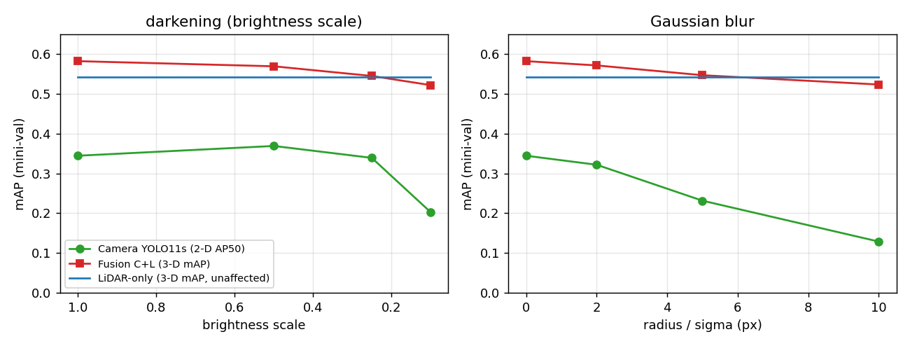
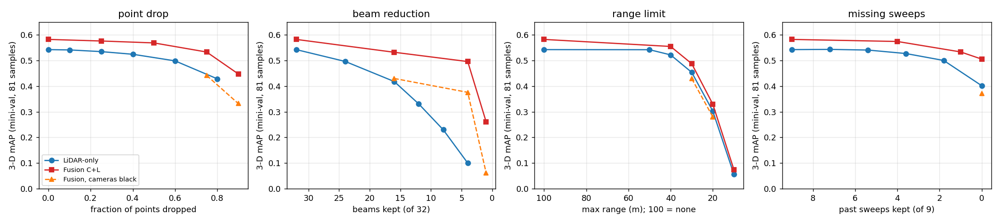
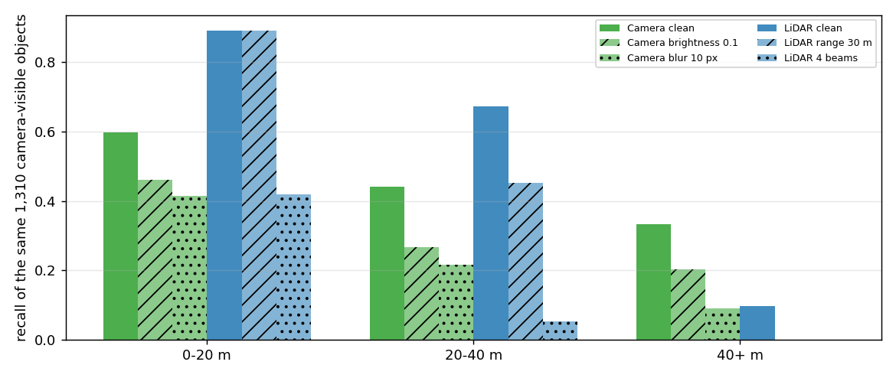
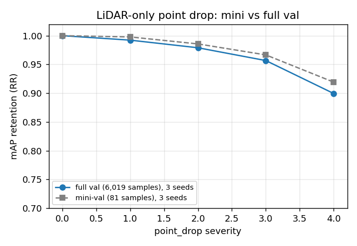

# Sensor degradation on nuScenes: LiDAR-only vs camera vs camera+LiDAR fusion

*CMPE-249 project, cross-lane comparison. Written 2026-11-18 by the LiDAR lane (Trevor).*

Three lanes, one question: how much does each sensing approach lose when its input is degraded?

| Lane | Owner | Model | Task / metric | Branch / folder |
|---|---|---|---|---|
| LiDAR-only | Trevor | BEVFusion LiDAR-only (TransFusion-L) | 3-D detection, nuScenes mAP / NDS | `trevor` branch, `trevor/` / `lidar/` |
| Camera | Ianna | YOLO11s, CAM_FRONT only | 2-D detection, AP50 (IoU 0.5) | `main`, `Camera/` |
| Fusion | Christian | BEVFusion camera+LiDAR | 3-D detection, nuScenes mAP / NDS | `BEVFusion` branch, `results/` |

Everything below is on **nuScenes mini-val: 81 keyframes from scenes 0103 and 0916**. All three lanes use this same set
(I checked that the camera lane's `mini_val_sample_tokens.txt` is exactly these 81 samples). The teammates' numbers are
taken verbatim from their repositories (copies in `lidar/report/inputs/`, commits in `PROVENANCE.txt`); I did not re-run
their code. Everything is regenerated by `python lidar/report/make_comparison.py`.

## 1. Headlines

1. **The LiDAR-only baseline is reproduced on the full val set** (6,019 samples): mAP **64.69** / NDS **69.25**, published
   64.68 / 69.28.
2. **Camera corruptions hurt the camera model badly, the fusion model mildly, and the LiDAR-only model not at all.**
   At the same darkening (x0.1) the YOLO11s retains 59 % of its AP50, fusion retains 90 % of its mAP, LiDAR-only 100 %.
   Blur of 10 px: 37 % / 90 % / 100 %.
3. **LiDAR corruptions are the opposite.** Range limits hurt LiDAR-only and fusion by the *same* fraction (30 m: 84 % vs 84 %;
   20 m: 56 % vs 57 %): the camera does not recover range (agrees with Christian's finding). Density losses (point drop,
   fewer past sweeps) hurt fusion less, and that gap is the cameras: with the cameras blacked out the fusion model degrades
   about like the LiDAR-only model.
4. **By distance, LiDAR is the near/medium sensor and the camera is the only one that sees far.** On the same 1,310
   camera-visible objects, LiDAR-only finds 89 % at 0-20 m and 67 % at 20-40 m (camera 60 % / 44 %), but only 10 % at 40+ m
   (camera 33 %), and nothing beyond its 54 m grid. A 30 m range limit takes LiDAR recall at 20-40 m from 67 % to 45 % and
   at 40+ m to 0 %.
5. **Mini-val is only good for comparing across lanes, not for headline numbers.** Where I can compare to the full val set,
   mini retention differs by up to 6 points (range 30 m: 84 % on mini, 78 % on full val), and mini's two scenes make the
   bootstrap confidence intervals meaningless.

## 2. Camera-side corruptions (identical parameters in all lanes)

Same brightness scale factors and blur radii in the camera and fusion lanes; LiDAR-only never reads the images.



| Condition | Camera YOLO11s (2-D AP50) | Fusion C+L (3-D mAP) | LiDAR-only (3-D mAP) |
|---|---|---|---|
| clean | 0.344 | 0.582 | 0.542 |
| brightness x0.5 | 0.369 (107%) | 0.569 (98%) | 0.542 (100 %, not affected) |
| brightness x0.25 | 0.339 (98%) | 0.545 (94%) | 0.542 (100 %, not affected) |
| brightness x0.1 | 0.203 (59%) | 0.522 (90%) | 0.542 (100 %, not affected) |
| blur 2 px | 0.322 (93%) | 0.571 (98%) | 0.542 (100 %, not affected) |
| blur 5 px | 0.232 (67%) | 0.547 (94%) | 0.542 (100 %, not affected) |
| blur 10 px | 0.129 (37%) | 0.523 (90%) | 0.542 (100 %, not affected) |
| all cameras black | - | 0.526 (90%) | 0.542 |

* The absolute values of the camera and the 3-D models are **not comparable** (2-D AP50 over 5 classes vs 3-D mAP over 10);
  compare the retention in brackets.
* Fusion never drops below 0.52 even with every camera black, and that is *below* the LiDAR-only model (0.542): in this
  fusion model the LiDAR branch carries almost everything, and the cameras add about +0.04-0.06 mAP when clean.
* The x0.5 camera result being above clean (107 %) is noise on 81 frames.

## 3. LiDAR-side corruptions



| Condition | LiDAR-only | Fusion C+L | Fusion, cameras black |
|---|---|---|---|
| clean | 0.542 | 0.582 | - |
| point drop 25 % | 0.534 (99%) | 0.576 (99%) | - |
| point drop 80 % (LiDAR-only) / 75 % (fusion) | 0.428 (79%) | 0.533 (92%) | 0.441 (76%) |
| 16 beams of 32 | 0.418 (77%) | 0.532 (91%) | 0.430 (74%) |
| 4 beams of 32 | 0.100 (18%) | 0.496 (85%) | 0.376 (65%) |
| range 40 m | 0.522 (96%) | 0.554 (95%) | - |
| range 30 m | 0.454 (84%) | 0.487 (84%) | 0.429 (74%) |
| range 20 m | 0.303 (56%) | 0.330 (57%) | 0.280 (48%) |
| range 10 m | 0.057 (10%) | 0.075 (13%) | - |
| no past sweeps | 0.402 (74%) | 0.505 (87%) | 0.371 (64%) |

Reading it:

* **Range**: LiDAR-only and fusion retain the same fraction at every limit. The cameras help fusion only against its own
  higher dependence on LiDAR (74 % without cameras vs 84 % with, at 30 m), not beyond what the LiDAR-only model does.
* **Point loss and missing history**: fusion retains more (92 % vs 79 % at roughly 75-80 % of points dropped; 87 % vs 74 %
  with no past sweeps). With cameras off the fusion model retains 76 % / 64 %, i.e. like LiDAR-only. This is the camera
  "rescue", and it is real but moderate for these corruptions.
* **4 beams is not a fair comparison, and I do not trust the 18 % vs 85 % gap.** The two implementations differ: mine keeps
  4 evenly spaced ring *indices* of the 32 (nuScenes ring indices are not evenly spaced in elevation, so this may keep
  mostly ground/sky rings), Christian uses BEVFusion's built-in `reduce_beams`. At 16 beams the two agree well (0.418 vs
  0.430 with cameras off). Before using the 4-beam row anywhere, rerun Christian's `--degrade reduce_beams=4` on the
  LiDAR-only checkpoint (his sweep script supports `--config`/`--checkpoint`), or rerun mine with his selection rule.
* **Other definition differences**: his degradations are applied after the 10 sweeps are merged, mine on each raw sweep
  before ego-motion alignment; his range limit may use 3-D distance, mine horizontal range; the severity values are not
  the same (see section 7). I matched conditions only where the parameter is equal (16/4 beams, 20/30/40 m, 0 past sweeps)
  or nearly so (25 %, 75 % vs 80 % point drop).

## 4. Which objects each sensor finds, and where

Camera lane's ground truth: 1,310 CAM_FRONT-visible objects (car, truck, bus, pedestrian, bicycle, motorcycle) with their
camera-frame distance. `common/tools/lane_recall.py` scores the LiDAR-only runs on exactly those objects (same annotation
tokens, same near/medium/far bins). The metrics differ (camera: 2-D IoU >= 0.5, confidence >= 0.25; LiDAR: 3-D box centre
within 2 m, score >= 0.25), so read this as "which objects are found", not as a score.



| Condition | 0-20 m | 20-40 m | 40+ m | of which 40-54 m | of which >54 m |
|---|---|---|---|---|---|
| objects (n) | 306 | 565 | 439 | 249 | 190 |
| Camera clean | 0.598 | 0.441 | 0.333 | - | - |
| Camera brightness x0.1 | 0.461 | 0.267 | 0.203 | - | - |
| Camera blur 10 px | 0.415 | 0.216 | 0.089 | - | - |
| LiDAR clean | 0.892 | 0.673 | 0.096 | 0.169 | 0.000 |
| LiDAR range 30 m | 0.892 | 0.451 | 0.000 | 0.000 | 0.000 |
| LiDAR range 20 m | 0.863 | 0.021 | 0.000 | 0.000 | 0.000 |
| LiDAR 16 beams | 0.824 | 0.444 | 0.018 | 0.032 | 0.000 |
| LiDAR 4 beams | 0.418 | 0.053 | 0.000 | 0.000 | 0.000 |
| LiDAR point drop 80 % | 0.780 | 0.317 | 0.019 | 0.033 | 0.000 |
| LiDAR no past sweeps | 0.807 | 0.476 | 0.032 | 0.056 | 0.000 |

* The two sensors fail in different places: the camera loses distance *and* image quality (far recall 33 % -> 9 % under
  blur), the LiDAR loses whatever the corruption removes (range, density) and is blind beyond 54 m in any case.
* 34 % of the camera-visible objects (439 of 1,310) are 40+ m away, and 190 of those (14 % of all) are beyond the LiDAR grid. That is the most direct
  argument for fusion in this data. A camera detection has no 3-D position without depth, so a camera "hit" at 50 m is
  not equivalent to a LiDAR hit.
* This is recall at one operating point (score >= 0.25); the LiDAR model's low-confidence far detections are not counted.

## 5. Full val set versus mini (LiDAR-only, my lane)



| Condition | mAP | NDS | RR (mAP), full val | RR, mini |
|---|---|---|---|---|
| clean (deterministic sweeps) | 0.6466 | 0.6921 | 100 % | 100 % |
| point_drop s1 (3 seeds) | 0.6415 | 0.6894 | 99.2% | 99.8% |
| point_drop s2 (3 seeds) | 0.6330 | 0.6843 | 97.9% | 98.6% |
| point_drop s3 (3 seeds) | 0.6186 | 0.6758 | 95.7% | 96.7% |
| point_drop s4 (3 seeds) | 0.5815 | 0.6529 | 89.9% | 91.9% |
| range_limit s3 (1 seed) | 0.5019 | 0.6236 | 77.6% | 83.7% |

* **Only 14 of the 41 full-val runs are finished** (clean, 12 point_drop, range_limit s3); the sweep continues on the
  laptop at roughly 2.2 h per run, so about 2.5 more days. The full-val bootstrap CIs, mRR and failure thresholds come
  after that. These numbers are point estimates.
* Mini has the same ordering but systematically retains a bit more than full val, and its 81 samples contain no
  construction vehicles, trailers or barriers at all (checked in the annotations), so the devkit scores those three classes
  AP 0 in every lane and every 3-D mini mAP is capped at 70 % of its value.
* **Sweep-sampling protocol does not matter here**: the published-style evaluation (random 9 of 10 sweeps) gives 64.69, my
  deterministic nearest-9 clean run 64.66 (full val). Christian's clean baseline uses random sweeps and mine uses nearest-9;
  with this check I consider the two clean baselines equivalent.

## 6. Speed (different hardware, indicative only)

| | Camera YOLO11s | Fusion BEVFusion | LiDAR-only BEVFusion node |
|---|---|---|---|
| Hardware | CPU only, WSL2, ROS 2 Jazzy | RTX 4070 SUPER, WSL2 | RTX 4050 laptop (6 GB), ROS 2 Foxy in Docker |
| Per-frame time | 45 ms inference (22 FPS) | 416 ms median latency, 2.5 Hz throughput (about 1 sweep in 8) | about 0.3-0.5 s per frame |
| Source | Ianna's ROS 2 latency CSVs | Christian's `ros2_timing_stress.md` | my replay check (not a stress test) |

Both 3-D detectors are far below the 20 Hz LiDAR rate on this class of GPU. Christian's finding that real-time latency
costs about a third of the accuracy (real-time mAP 0.378 vs 0.578) should apply to the LiDAR-only node too, but I have not
measured it. In my node roughly 200 ms per frame is the deterministic voxelizer; switching it off is about 2x faster at
negligible score change (not used in any result here).

## 7. What does not line up yet (to settle as a team)

1. **Severity values differ per lane.** Mine: point drop 10/25/40/60/80 %, beams 24/16/12/8/4, range 50/40/30/20/10 m,
   missing sweeps 20-100 %. Christian: point drop 25/50/75/90 %, beams 16/4/1, range 40/30/20/10 m, sweeps 4/1/0. Ianna:
   brightness x0.5/0.25/0.1, blur 2/5/10 px (Christian uses the same camera values). Proposal: keep each lane's levels
   but tabulate matched conditions, as here; or add mine at his levels (about 20 mini runs, about 20 minutes).
2. **Beam reduction definition** (section 3). Needs one cross-check run before any cross-lane beam claim.
3. **Camera lane has no LiDAR corruption, LiDAR lane has no camera corruption** by construction, and the camera `hardware`
   column in the shared CSV is empty (I use `laptop`, `hpc_a40`).
4. **Camera 2-D vs 3-D metric**: if we want a single number across lanes, the camera detections need the 3-D projection
   scorer. Only retention ratios are comparable today.
5. **Mini-val statistics**: 2 scenes cannot give usable confidence intervals; cross-lane claims should be re-checked on the
   full val set for the two 3-D lanes once my sweep finishes (Christian's fusion sweep on full val is not run either; it
   would need the camera data, which I have not downloaded).

## 8. Reproducing this report

```
python lidar/report/make_comparison.py        # tables.md and figures/*.png
# LiDAR-only recall on the camera lane's objects (needs nuScenes mini + the camera lane's ground_truth.csv):
python common/tools/lane_recall.py --sweep-dir /results/lidar_sweep_mini --nuscenes-root data/nuscenes \
    --version v1.0-mini --camera-gt Camera/results/camera_shared_mini_val/ground_truth.csv --out lane_recall_mini.csv
```

Inputs: `lidar/results/mini_results.csv` (LiDAR-only sweep through `common/tools/bootstrap_sweep.py`),
`lidar/results/lane_recall_mini.csv`, `lidar/results/fullval_sweep_partial.csv`, and the teammates' files in
`lidar/report/inputs/`. `lane_recall.py` is not covered by unit tests yet; its 1,310-object total matches the camera lane's
(306 + 565 + 439).
